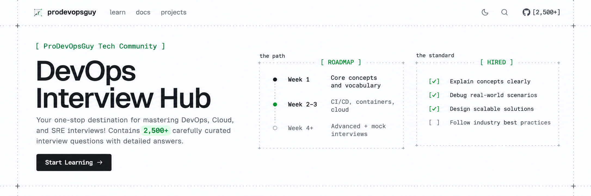

# DevOps Interview Hub

[](https://interviews.prodevopsguytech.com)

A comprehensive resource for DevOps, Cloud, and SRE interview preparation. Contains **2,500+ carefully curated interview questions and scenarios** with detailed answers — organized into **12 sections** and **4 difficulty levels**, covering all major DevOps tools, cloud platforms, and best practices.

**🌐 Live site:** [interviews.prodevopsguytech.com](https://interviews.prodevopsguytech.com) · **📦 Question banks:** [NotHarshhaa/DevOps-Interview-Questions](https://github.com/NotHarshhaa/DevOps-Interview-Questions)

## 👤 Creator

<p>
  <a href="https://github.com/NotHarshhaa">
    
  </a>
</p>

**HARSHHAA** — [GitHub](https://github.com/NotHarshhaa) · [Telegram](https://t.me/prodevopsguy) · [Blog](https://blog.prodevopsguy.xyz)

**AI Infrastructure | DevOps & MLOps | AI Agents & MCP | LLMOps | Platform Engineering | Forward Deployed Engineering**

## 📚 What's Inside

| Section | Focus | Levels |
|---|---|---|
| Core Concepts | DevOps principles, culture, the big picture | 4 |
| Automation & Scripting | Bash, Python, YAML, Groovy | 4 |
| CI/CD | Pipelines, deployment strategies, release management | 4 |
| Containers | Docker, Kubernetes, orchestration | 4 |
| Cloud | AWS, Azure, GCP | 4 |
| Infrastructure as Code | Terraform, provisioning, drift management | 4 |
| Linux & System Administration | Kernel, systemd, storage, performance tuning | 4 |
| Version Control | Git internals, branching, GitOps | 4 |
| Monitoring & Logging | Metrics, logs, traces, alerting | 4 |
| Networking & Security | Networking fundamentals, security practices | 4 |
| Best Practices | Real-world patterns, case studies | 4 |
| Mock Interviews | 50 senior scenario simulations | 4 |

Every section ships a **Getting Started** guide (curated learning path) and a **Master Collection** page holding the complete raw question bank. Each question includes a model answer, the follow-ups interviewers actually ask, and the trap most candidates fall into.

## ✨ Features

- 2,500+ interview questions and scenarios with model answers
- Coverage of major DevOps tools, cloud platforms, Linux, and Git
- Collapsible section folders with on-this-page navigation
- Full-text docs search (`Ctrl/Cmd + K`)
- Text-drawn figures — timelines, checklists, tables and charts that stay readable as plain text
- Beginner-friendly yet comprehensive for experienced engineers

## 🚀 Run Locally

This repo is the website. Requires **Node.js 20+** and **pnpm**.

```bash
pnpm install
pnpm dev      # http://localhost:3000
```

| Command | What it does |
|---|---|
| `pnpm dev` | Start the dev server |
| `pnpm build` | Production build (all pages prerendered) |
| `pnpm start` | Serve the production build |
| `pnpm lint` | ESLint |
| `pnpm typecheck` | TypeScript |

## 📝 Adding Content

The docs live in [`content/docs/`](content/docs) — plain MDX, no import lines needed. Components (`Steps`, `Callout`, `Terminal`, `Quote`, buttons, tables, code frames) resolve automatically.

1. Create `content/docs/<your-section>/beginner.mdx` with frontmatter:

   ```mdx
   ---
   title: Beginner Level
   description: What this level covers.
   root: your-section
   ---

   # Beginner Level

   <Steps>

   <Step>
   **Your question here?**

   Your model answer, the follow-ups, and the trap to avoid.
   </Step>

   </Steps>
   ```

2. Register the section in [`content/docs/meta.json`](content/docs/meta.json):

   ```json
   { "folder": "your-section", "title": "Your Section" }
   ```

Sidebar, search, pager, and sitemap pick it up automatically — no other wiring.

## 🧭 For Readers

1. Visit the [documentation](https://interviews.prodevopsguytech.com/docs) to explore all topics
2. Browse through categories like Cloud, CI/CD, Automation & Scripting, Linux, Version Control
3. Use the search functionality (`Ctrl/Cmd + K`) to find specific topics
4. Study the detailed explanations and examples — then practice with the [mock interviews](https://interviews.prodevopsguytech.com/docs/mock-interviews/getting-started)

📌 **Follow for Updates:**  
🔗 **GitHub**: [@NotHarshhaa](https://github.com/NotHarshhaa)  
📝 **Blog**: [ProDevOpsGuy](https://blog.prodevopsguy.xyz)  
💬 **Telegram Community**: [Join Here](https://t.me/prodevopsguy)  

---

## ⭐ Support This Project  

If this repository **helped you**, please:  
✅ **Star** ⭐ the repository  
✅ **Share** it with fellow DevOps learners  
✅ **Contribute** by adding new questions  

🚀 **Happy Learning & Best of Luck for Your DevOps Interviews!** 🚀  


